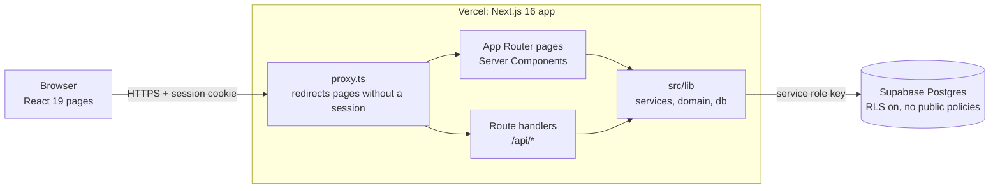
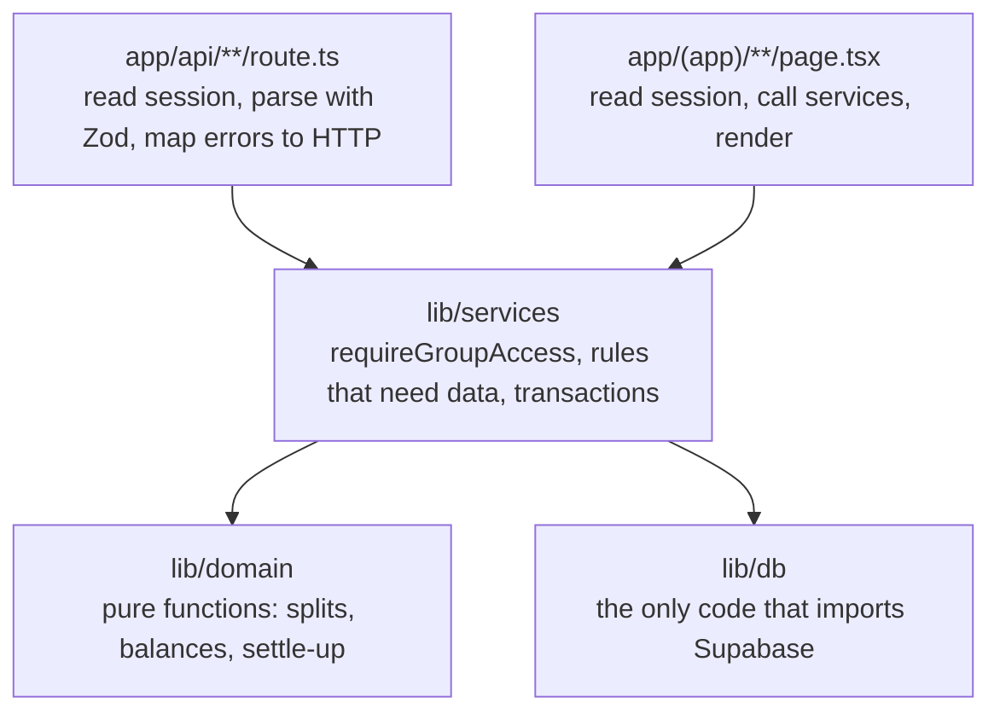
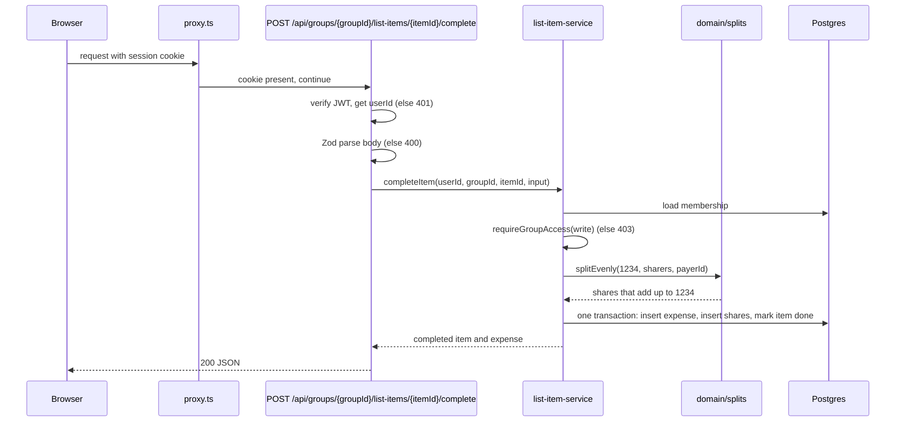
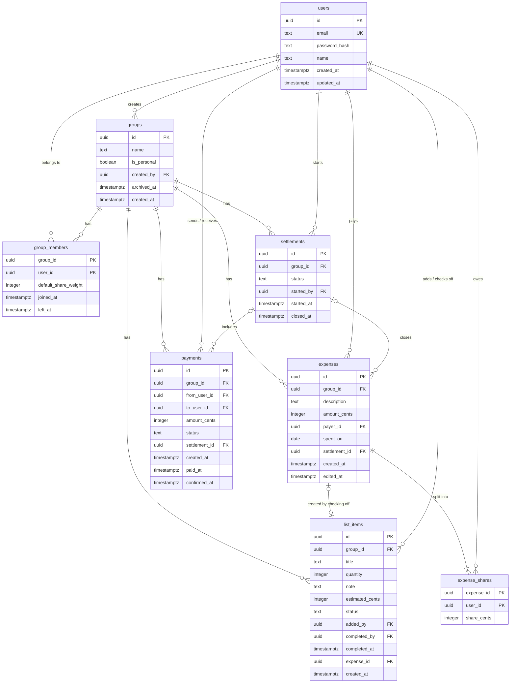
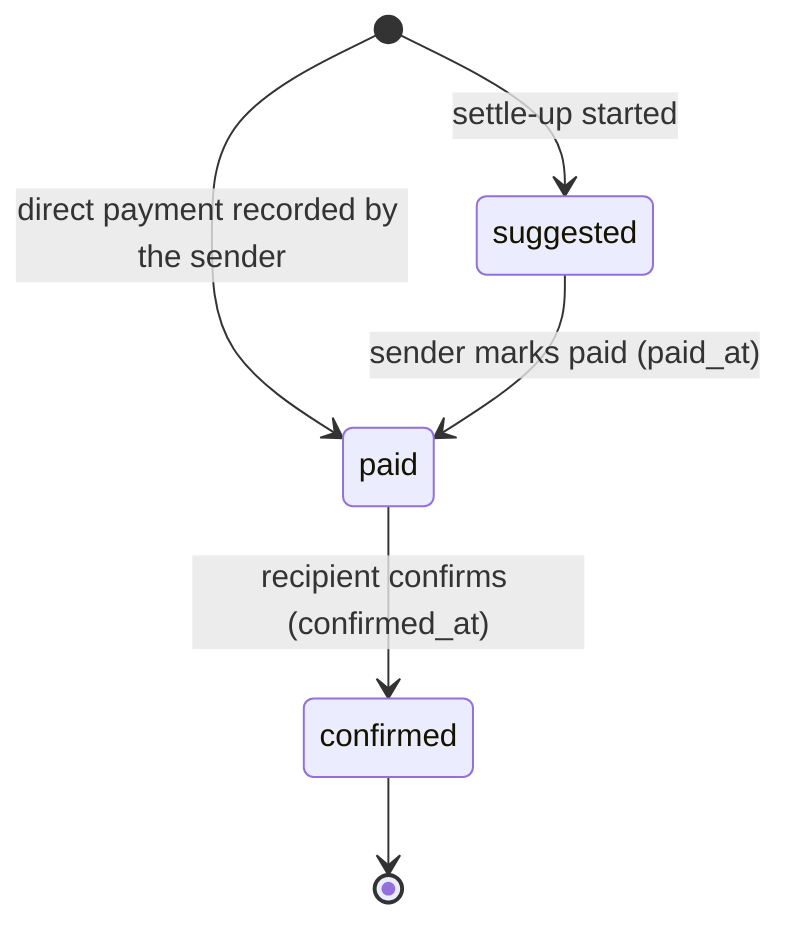

# Architecture

How LifeBoard is put together: the parts of the system, how a request moves through them, and the database schema. Behavioral rules (money, splits, balances, access) live in [AGENTS.md](../AGENTS.md) Section 6; this document shows where each rule is enforced. Routes and error codes are in [api/openapi.yaml](api/openapi.yaml).

## 1. System overview

LifeBoard is one Next.js 16 app deployed on Vercel. The same app serves the pages and the REST API. Supabase hosts the Postgres database and nothing else: we do not use Supabase Auth, Storage, or Realtime.



- The browser never talks to Supabase. Only server code holds `SUPABASE_SERVICE_ROLE_KEY`, and Row Level Security with no policies blocks every other key.
- Pages read data through the same services as the API, so a page and its API route always agree.
- Balances, splits and settle-up suggestions are calculated on the server and sent to the browser as finished numbers.

## 2. Layers

Code flows in one direction. A layer may call the layers below it, never above.



| Folder | Responsibility | Must not |
|---|---|---|
| `src/proxy.ts` | Redirect page requests without a valid `session` cookie to `/login`. | Be the only auth check. Route handlers check again. |
| `src/app/(auth)` | Login and register pages. | Read group data. |
| `src/app/(app)` | Signed-in pages: overview, personal space, groups. | Calculate money. |
| `src/app/api` | Route handlers. Read the user id from the session, validate input with Zod, call one service, return JSON. | Trust a user id from the request body, or query the database. |
| `src/lib/validation` | Zod schemas for request bodies and query strings. | Contain business rules. |
| `src/lib/services` | One file per feature, such as `expense-service.ts`. Calls `requireGroupAccess`, loads data, calls domain functions, writes. | Return HTTP responses. |
| `src/lib/domain` | Pure TypeScript: even and custom splits, balances, the fewest-payments search. No I/O. 100% test coverage. | Import `lib/db`, Next.js, or Supabase. |
| `src/lib/db` | Supabase client and one query module per table. Maps `snake_case` columns to `camelCase` objects. Starts with `import "server-only"`. | Contain business rules. |
| `src/lib/auth` | Password hashing (`bcryptjs`, cost 12), JWT signing and checking (`jose`), cookie helpers. | Store tokens anywhere except the `session` cookie. |
| `src/lib/http` | Typed errors (`errors.ts`) and their mapping to the error body in the OpenAPI spec. | Know about features. |
| `src/components` | `ui/` primitives and feature folders, following [DESIGN.md](../DESIGN.md). | Fetch data in Client Components when a Server Component can. |

## 3. A request, end to end

Example: a member checks off a list item for $12.34 shared by two members (user flow 2).



Writes that touch several tables (registering an account with its personal space; an expense with its shares; checking off or unchecking a list item; closing a settlement) run in a single Postgres function called through `rpc`, so a half-finished write, such as an account without its personal space or an expense without its shares, can never exist.

## 4. Authentication and access control

**Session.** Register and login return a JWT signed with `JWT_SECRET` (HS256, 24-hour expiry), stored in an `httpOnly`, `Secure`, `SameSite=Lax` cookie named `session`. The token holds only the user id. An expired or invalid token gives `401`, and pages redirect to `/login`.

**Two checks per request.**

1. `proxy.ts` runs first. A page request without a valid cookie is sent to `/login`. An API request without one gets `401` and the error body, except `POST /api/auth/register`, `/login` and `/logout`. It is a first check, not the security boundary.
2. Every route handler and every page reads the session itself and passes the user id to the service.

**`requireGroupAccess(userId, groupId, mode)`** is the one place access is decided. Every service calls it before reading or writing group data.

| Who | `read` | `write` |
|---|---|---|
| Current member (`left_at` is null) of an active group | Everything | Allowed |
| Current member of an archived group (`archived_at` set) | Everything | `403` |
| Former member (`left_at` set) | Rows created before their `left_at` | `403` |
| Anyone else, including other users' personal spaces | `403` | `403` |

A personal space is a group with `is_personal = true` and exactly one member, its owner. Invitations to it return `403`.

`requireGroupAccess` returns the group and `readUntil`: the former member's `left_at`, or null for a current member. A service that lists rows must show a former member only rows created before `readUntil`. A group that does not exist gets the same `403` as one the user is not in, so ids can't be probed. A `groupId` that is not a UUID is rejected with `400` by the route before the service runs.

## 5. Database schema

Postgres in Supabase, changed only through SQL files in `supabase/migrations/`. Conventions:

- Table names are plural `snake_case`. Primary keys are `uuid` with `gen_random_uuid()`.
- Money is `integer` cents in columns ending in `_cents`. Timestamps are `timestamptz` in columns ending in `_at`. The date an expense happened is a `date`.
- Every table has Row Level Security on and no policies. `anon` and `authenticated` have no grants.
- A person named in a group's row (payer, sharer, sender, recipient, who added or checked off an item, who started a settle-up) must be a member of that group, current or former, so a member's history survives when they leave. A composite foreign key to `group_members (group_id, user_id)` enforces it, or a trigger for `expense_shares`, which has no `group_id`. Services check that the member is current before a new write.
- An expense or settlement referenced from another row must be in the same group, through composite foreign keys to `unique (group_id, id)`.

### Entity relationships



### Tables

**`users`**: one row per account.

- `email` is unique and must equal `lower(email)`.
- `password_hash` is a bcrypt hash. The plain password is never stored or logged.
- `updated_at` is set by a trigger on every update. Code never writes it.

**`groups`**: shared groups and personal spaces.

- `is_personal` marks a user's personal space. Each user has exactly one, created at registration: `register_user(p_email, p_password_hash, p_name)` inserts the user (email trimmed and lowercase), the personal space and the owner's membership in one transaction and returns the user id. A partial unique index on `(created_by) where is_personal` enforces it.
- `archived_at` is set when the last member leaves; the group is then read-only.

**`group_members`**: who is or was in a group. Primary key `(group_id, user_id)`.

- `default_share_weight` is a positive integer. A 60/40 group stores 3 and 2. New expenses split by these weights unless the payer overrides them. Even groups store 1 for everyone.
- `left_at` is set when a member leaves; the row stays so history and read access still work.
- A trigger rejects a join or rejoin that would make a 13th current member (`MAX_GROUP_MEMBERS = 12`). It locks the group row, so two joins cannot race for the last place.

**`list_items`**: things to do or buy.

- `status` is `open` or `done`. While `open`, `completed_by`, `completed_at` and `expense_id` are null. When `done`, `completed_by` and `completed_at` are set.
- `estimated_cents` and `quantity` are optional and must be positive when present.
- `expense_id` is null when the item was done with no cost. It must be an expense of the same group, and an expense belongs to one item at most. If that expense is deleted on its own, only `expense_id` becomes null and the item stays done.
- Unchecking a done item reopens it: one transaction deletes its expense and sets `status` back to `open` with `completed_by`, `completed_at` and `expense_id` null. Only the member who checked it off can uncheck it, and only while the expense is unsettled.

**`expenses`**: one cost, personal or shared.

- `amount_cents >= 0`. `payer_id` must be a member of the group.
- An expense with a cost is written together with its shares by `create_expense(p_group_id, p_description, p_amount_cents, p_payer_id, p_spent_on, p_shares)`, where `p_shares` is a JSON array of `{"user_id", "share_cents"}`. It returns the expense id and fails with `23514` if the shares don't add up. The split itself is calculated before the call, in `lib/domain`.
- `settlement_id` is null while unsettled, and must be a settlement of the same group. Setting it locks the expense: services reject edits and deletes with `409`.
- `edited_at` is set on every edit so the UI can show "edited".

**`expense_shares`**: who shares an expense and how much. Primary key `(expense_id, user_id)`.

- `share_cents >= 0`. The person must be a member of the expense's group (a trigger, see the conventions above).
- Deferred constraint triggers on both tables check at commit that the shares of an expense add up exactly to `amount_cents`. Writing an expense and its shares in one transaction passes; changing one share, removing one, or changing the amount on its own fails. Editing an expense therefore needs one call that replaces the amount and the shares together, as `create_expense` does for a new one.
- Shares are deleted with their expense (`on delete cascade`).

**`payments`**: money sent outside the app.

- `from_user_id` and `to_user_id` are different members of the group. `amount_cents > 0`.
- `status` is `suggested`, `paid` or `confirmed`. See the payment lifecycle below. A `suggested` payment always has a `settlement_id`.
- `paid_at` is set when the sender marks it paid; `confirmed_at` when the recipient confirms. A check constraint requires neither for `suggested`, only `paid_at` for `paid`, and both for `confirmed`, with `confirmed_at` no earlier than `paid_at`.
- `settlement_id` points to the settle-up that suggested it, or is null for a direct payment until the period closes. It must be a settlement of the same group.

**`settlements`**: one settle-up period.

- `status` is `open`, `closed` or `cancelled`. A partial unique index allows one `open` settlement per group.
- `closed_at` is when it ended, by closing or by cancelling. It is set exactly when the status is not `open`, and is never before `started_at`.
- `started_by` must be a member of the group.

Every foreign key is `on delete restrict` except `expense_shares.expense_id` (`cascade`) and `list_items.expense_id` (`set null`, which clears only `expense_id`). Nothing else is ever hard-deleted, so history stays intact.

### Demo data

`supabase/seed.sql` loads after the migrations on `npx supabase db reset`, and on `npx supabase start` with a new database. It never reaches the hosted database. It registers Demo, Sam and Jo (`demo@lifeboard.test`, `sam@lifeboard.test`, `jo@lifeboard.test`, all with the password `lifeboard-demo`), puts them in a group called Flat with four expenses, two list items and a confirmed payment, and leaves Demo owed $1.98, Jo owing $8.02 and Sam owed $6.04. `supabase/tests/seed.test.ts` checks that it is there.

### Payment lifecycle

The app never moves money, so it cannot know when money arrives. Two people each tell it what happened: the sender says "I sent it", and the recipient says "I got it". Only the recipient's confirmation changes balances, so a sender cannot clear a debt alone.



| Status | Meaning | Who moves it on | Counts in balances |
|---|---|---|---|
| `suggested` | The settle-up says this payment should happen. Nobody has sent money yet. | The sender, by marking it paid | No |
| `paid` | The sender says they sent the money, for example by Venmo. | The recipient, by confirming | No |
| `confirmed` | The recipient says the money arrived. Final. | Nobody | Yes |

The earlier draft had only `pending` and `confirmed`. That could not tell "the app suggested this" from "I sent it", so the recipient would not know which payments to look for, and the settle-up screen could not show who has paid (user flow 5).

### Settle-up periods

- **Starting.** Any current member starts a settle-up. The app takes the balances at `started_at` and creates the fewest `suggested` payments that clear them.
- **During a settle-up.** Members can keep adding expenses and direct payments. Anything created after `started_at` belongs to the next period and does not change the suggested payments.
- **Closing.** When every payment in the settle-up is `confirmed`, one transaction sets `status = closed` and `closed_at`, and sets `settlement_id` on the expenses created before `started_at` and the direct payments confirmed before `started_at`. Those rows are now locked, and the period's balances are zero.
- **Cancelling.** Any current member can cancel an open settle-up while every one of its payments is still `suggested`. Cancelling sets `status = cancelled` and `closed_at`, and deletes those payments. Expenses stay unsettled and can be settled again later. Once anyone marks a payment `paid`, the settle-up can only end by closing.

## 6. Where the money rules live

| Rule (AGENTS.md Section 6) | Enforced in |
|---|---|
| Integer cents | Column types; Zod rejects non-integers; `MoneyText` formats only for display |
| Even split, leftover cents to the payer | `lib/domain/splits.ts` |
| Custom split must equal the total | Zod and `lib/domain/splits.ts`; deferred trigger as a backstop |
| Balances over unsettled expenses and confirmed payments | `lib/domain/balances.ts`, fed by `lib/db` queries for the current period |
| Fewest payments, exact bitmask search, at most 12 members | `lib/domain/settle-up.ts`; member cap trigger |
| One access check | `lib/services/access.ts` (`requireGroupAccess`) |
| Only the payer edits, only while unsettled | Expense service; `409` once `settlement_id` is set. Unchecking a list item uses the same check, because it deletes the expense |
| Leave only with a zero balance; archive on last leave | Membership service, in one transaction |

**Balance of member _m_ for the current period** (expenses and payments whose `settlement_id` is null or points to the open settlement):

```math
\text{balance}(m) = \sum_{e:\ \text{payer}=m} \text{amount}_e \;-\; \sum_{e} \text{share}_{e,m} \;+\; \sum_{p\ \text{confirmed}:\ \text{from}=m} \text{amount}_p \;-\; \sum_{p\ \text{confirmed}:\ \text{to}=m} \text{amount}_p
```

Positive means the group owes _m_; negative means _m_ owes. Balances in a group always add up to zero, which the domain tests check.

## 7. Environments and configuration

| Environment | App | Database |
|---|---|---|
| Local | `npm run dev` | `npx supabase start` (Docker), migrations applied with `npx supabase db reset` |
| CI | GitHub Actions jobs in [ci.yml](../.github/workflows/ci.yml) | Local Supabase started inside the `db-test` job, which runs `npm run test:db` |
| Preview and production | Vercel (a preview per pull request, production from `main`) | Hosted Supabase project |

Variables are listed in [.env.example](../.env.example). `SUPABASE_URL` and `SUPABASE_SERVICE_ROLE_KEY` are read only in `lib/db`; `JWT_SECRET` only in `lib/auth`. None has a `NEXT_PUBLIC_` prefix.

## 8. Decisions

- **No ORM.** The first version of issue #3 suggested Prisma, but [AGENTS.md](../AGENTS.md) forbids an ORM. We use plain SQL migrations and `@supabase/supabase-js` with the service role key, behind `lib/db`.
- **Own auth instead of Supabase Auth.** Accounts, hashing and JWTs are part of the course requirements, so we build them with `bcryptjs` and `jose`.
- **One list table.** The first version of issue #3 named `TodoItem` and `ShoppingItem`. The PRD treats them as one list of "things to do or buy", so both are rows in `list_items`. Issue #3's `ExpenseSplit` is `expense_shares`, and `defaultSplitRatio` is `group_members.default_share_weight`.
- **A personal space is a group.** It reuses the list, expense and access code. `is_personal` turns off invitations, members and balances.
- **Settle-up runs on a snapshot.** Expenses and direct payments added during an open settle-up go to the next period, and any current member can cancel a settle-up until someone marks one of its payments paid. See [Settle-up periods](#settle-up-periods).

## 9. Known limitations

- Once someone marks a payment `paid`, the settle-up cannot be cancelled. If another member never pays, it stays open and the group cannot start a new one. Members sort this out outside the app.
