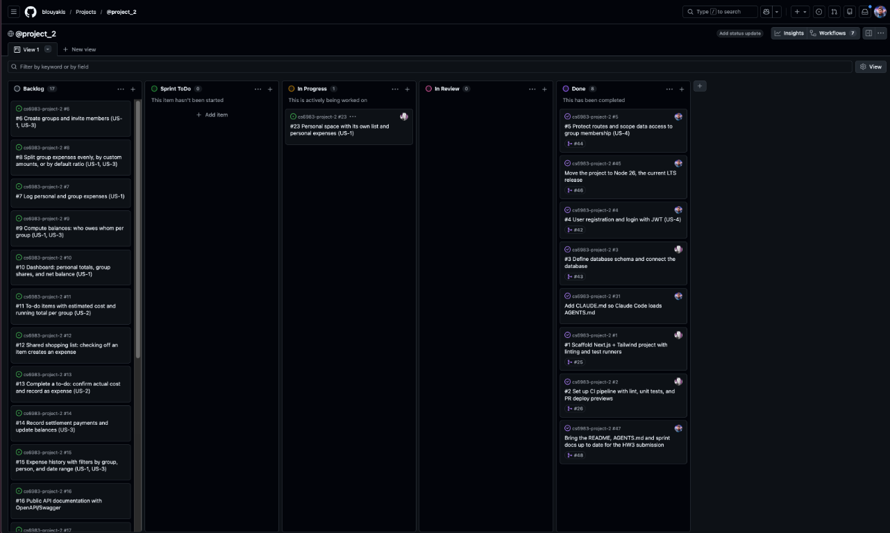
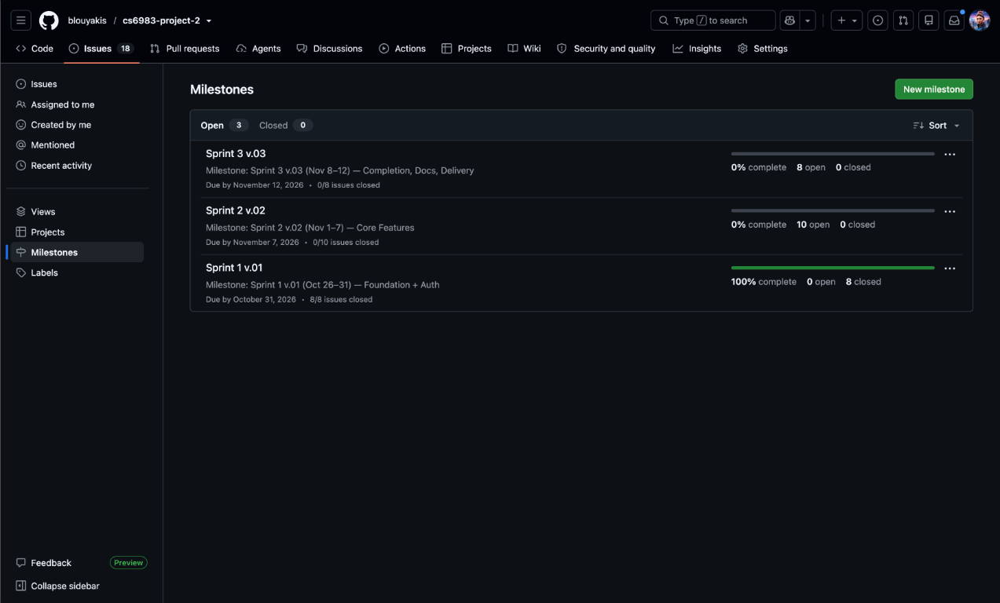

# HW3: Rules Files and Agile Workflow for AI-Assisted Development

**Project:** LifeBoard (CS6983 AI Coding · Project 2 · Fall 2026)
**Team:** Barbara Louyakis ([@blouyakis](https://github.com/blouyakis)) · Ziye Huang ([@SeraphimHuang](https://github.com/SeraphimHuang))

## 1. GitHub repository and Scrum setup

| | Link |
|---|---|
| Repository | <https://github.com/blouyakis/cs6983-project-2> |
| Project board | <https://github.com/users/blouyakis/projects/3> |
| Milestones | <https://github.com/blouyakis/cs6983-project-2/milestones> |
| Issues | <https://github.com/blouyakis/cs6983-project-2/issues> |
| Communication log | [Google Sheet](https://docs.google.com/spreadsheets/d/1xbZLsDWi8kCrbk7bfrR18Wg7M5aKSlbO/edit?gid=229896090#gid=229896090) |

**Board.** The project board uses the Board layout with five columns: Backlog, Sprint ToDo, In Progress, In Review and Done. The board is public. Issues move from Sprint ToDo through In Progress and In Review to Done, and a pull request linked to an issue shows on its card.



*The board on Oct 30, 2026 at 9:54 pm ET: all eight Sprint 1 issues are in Done.*

**Milestones.** Sprint 1 v.01 (Oct 26–31, foundation and auth) is due Oct 31, Sprint 2 v.02 (Nov 1–7, core features) is due Nov 7, and Sprint 3 v.03 (Nov 8–12, completion, docs and delivery) is due Nov 12.



*The milestones on Oct 30, 2026 at 9:55 pm ET: Sprint 1 is 8 of 8 closed.*

**Issues.** There are 26 issues: 8 in Sprint 1, 10 in Sprint 2 and 8 in Sprint 3. Every issue has an action-oriented title, an acceptance-criteria checklist in its body, a type label (`feature`, `chore`, `docs` or `test`), a priority label and a milestone. Each of the eight user stories in [`docs/user-stories.md`](../user-stories.md) (US-1 to US-8) is covered by one or more issues, and the story is named in the issue title, for example "#4 User registration and login with JWT (US-4)". Issues [#1](https://github.com/blouyakis/cs6983-project-2/issues/1) to [#5](https://github.com/blouyakis/cs6983-project-2/issues/5) are the five planned for Sprint 1, and all five are closed with their acceptance criteria checked.

## 2. Rules file

[`AGENTS.md`](https://github.com/blouyakis/cs6983-project-2/blob/main/AGENTS.md) is in the project root. `CLAUDE.md` contains one line, `@AGENTS.md`, so Claude Code loads it. Each section starts with a one-line *Why* note, and every change is logged in the Changelog at the bottom.

| What the assignment asks for | Where it is in `AGENTS.md` |
|---|---|
| Tech stack and versions | §1 |
| Architecture overview: folder structure, key patterns | §2 |
| Naming conventions and coding standards | §3 |
| Testing strategy: frameworks, order, coverage goals | §4 |
| Link to the PRD, and user flows to follow | §5 links [`docs/PRD.md`](../PRD.md) and [`docs/user-stories.md`](../user-stories.md), and gives eight user flows. They are also the Playwright scenarios |
| Mockup descriptions and key UI components with expected behavior | §5 links [`DESIGN.md`](../../DESIGN.md) and the mockups in [`docs/design/`](../design/) (summary below) |
| Branch names, commit format, PR workflow, how to reference issues | §7 |
| Do's and don'ts, preferred libraries, security and accessibility | §8 |
| Rules that must always hold (money, access, settle-up) | §6 |

**Designs and components, in short.** `DESIGN.md` describes the colors and nine screens: Overview, Groups, One group, Shared list, Members and bill, Settle up, New entry, Edit expense and Personal space. Each screen has a desktop mockup, a phone mockup, or both. It also describes the planned components and how each behaves, in families: Shared (`MoneyText`, `FormSheet`, `Avatar`, `Badge`, `Toggle`, `ChipPicker`), Navigation (`AppSidebar`, `TabBar`, `PageHeader`), Overview and groups (`GroupCard`, `BalanceSummary`, `ExpenseTable`), Lists (`ListItemRow`, `EntryForm`, `SplitEditor`), Money (`ItemizedBill`, `StandingsCard`, `PaymentCard`) and Members (`MemberList`, `InviteForm`, `MovingOutCard`). Two rules from it matter most: every amount goes through `MoneyText`, and owing and being owed are always written in words, never shown by color alone.

## 3. Before/after comparison (issue #4)

**Feature:** [#4](https://github.com/blouyakis/cs6983-project-2/issues/4) User registration and login with JWT (US-4), Sprint 1, labels `feature` and `priority: high`.

### 3.1 Methodology

Same feature, two clean runs, one variable changed: whether the rules file is present.

| | Run A — WITHOUT rules | Run B — WITH rules |
|---|---|---|
| Working copy | git worktree `cs6983-project-2-norules` | main checkout `cs6983-project-2` |
| Branch | `feature/4-auth-no-rules` (from `main` @ `b2d7380`) | `feature/4-auth` (from `main` @ `b2d7380`) |
| Rules present | No. `AGENTS.md`, `CLAUDE.md`, `DESIGN.md`, `docs/architecture.md`, `docs/api/openapi.yaml` removed in commits `86fbe33` and `20b472c` | Yes. `CLAUDE.md` → `@AGENTS.md`, plus DESIGN.md, architecture.md, openapi.yaml |
| Chat | Fresh Claude Code session in VS Code | Fresh Claude Code session in VS Code |
| Prompt | Brief description below, identical in both runs | Same prompt, verbatim |
| Tool | Claude Code (VS Code extension), same model | Same |

**Prompt used in both runs (verbatim):**

```text
Implement user registration and login for a Next.js 16 app.

Feature: User Registration & Login (US-4)
- Users register with email and password
- Passwords must be hashed and never stored plain text
- Reject duplicate emails with clear error message
- Reject passwords shorter than 8 characters with clear error message
- Users log in and receive a JWT token
- Sessions should expire; invalid tokens return 401
- Users can log out

Tech stack: Next.js 16 (App Router), React 19, TypeScript (strict),
Tailwind CSS 4, Supabase Postgres (database only), jose, bcryptjs, Zod 4, Vitest, Playwright

Database: The users table already exists with: id, email, password_hash, name, created_at, updated_at
Supabase client is in src/lib/db/client.ts

Reference the database schema in: docs/architecture.md
```

The last line points at `docs/architecture.md`. In Run A that file had been removed with the rules (commit `20b472c`), so the agent had no schema or auth spec to read and worked from the prompt alone. In Run B the file is present; it is one of the PRD/design references AGENTS.md §2 and §5 link to, so it counts as part of the rules context under test.

**Known limitation.** The brief already named the library stack (jose, bcryptjs, Zod, Vitest, Playwright) and the `users` columns, so Run A was not "zero context"; it tested the rules file's effect on *how* those libraries are used (security parameters, layering, naming, tests, design), not on library choice. Everything else — section numbers, security values, folder layout, naming rules — was available only to Run B through `AGENTS.md`.

**Where to see the code.** Run A is on the [`feature/4-auth-no-rules`](https://github.com/blouyakis/cs6983-project-2/tree/feature/4-auth-no-rules) branch, whose last commit is [`58db85f`](https://github.com/blouyakis/cs6983-project-2/commit/58db85f). Run B is on the [`feature/4-auth`](https://github.com/blouyakis/cs6983-project-2/tree/feature/4-auth) branch and was merged to `main` in [pull request #42](https://github.com/blouyakis/cs6983-project-2/pull/42), which closes issue [#4](https://github.com/blouyakis/cs6983-project-2/issues/4).

### 3.2 Run A — WITHOUT rules (what was actually produced)

17 files touched, ~710 lines (uncommitted work captured on `feature/4-auth-no-rules`). Observations are from reading the code.

**Files**
```
src/lib/auth/password.ts   src/lib/auth/token.ts   src/lib/auth/session.ts   src/lib/auth/schemas.ts
src/lib/auth/auth.test.ts  (one test file for three modules)
src/app/api/auth/{register,login,logout,me}/route.ts
src/app/api/auth/routes.test.ts  (one test file for four routes)
src/app/auth-form.tsx  src/app/auth-nav.tsx  src/app/login/page.tsx  src/app/register/page.tsx
```

**What it got right without rules**
- bcryptjs hashing; min 8 chars via Zod; emails trimmed and lower-cased in the schema
- jose HS256 with the algorithm pinned on verify; `JWT_SECRET` length check; expiry tested
- Generic login error, and a dummy-hash compare so unknown emails take the same time as wrong passwords
- `import "server-only"` on `session.ts`; cookie is `httpOnly`, `SameSite=Lax`, named `session`
- Duplicate email → 409 (pre-check plus Postgres `23505` fallback); short password → 400

**Where it diverged from AGENTS.md** (section numbers refer to AGENTS.md)

| Area | AGENTS.md says | Run A did | Evidence |
|---|---|---|---|
| §8 Security | bcrypt cost **12** | cost **10** | `password.ts`: `const COST = 10` |
| §8 Security | tokens expire after **24 h** | **7 days** | `token.ts`: `SESSION_TTL_SECONDS = 60*60*24*7` |
| §8 Security | cookie always `Secure` | `Secure` only in production | `session.ts`: `secure: process.env.NODE_ENV === "production"` |
| §8 Security | store the JWT only in the `session` cookie; never `localStorage` | token also returned in the JSON body and accepted as `Authorization: Bearer` | `register/route.ts`, `login/route.ts`: `NextResponse.json({ user, token })`; `session.ts#readToken` |
| §8 Security | protect pages in `proxy.ts`; expired → redirect to `/login` | no `proxy.ts`; nothing redirects | file absent; issue AC "expired sessions redirect to login" unmet |
| §2 Architecture | route → service → db; **only `lib/db` talks to Supabase** | routes and `lib/auth/session.ts` call `getDb().from("users")` directly; no service layer | every `route.ts`; `session.ts#getCurrentUser` |
| §2 / §3 | services throw typed errors from `lib/http/errors.ts` | inline `NextResponse.json({ error }, { status })` in each route | all four routes |
| §3 Naming | JSON keys camelCase | `created_at` returned to the client | `session.ts`: `PUBLIC_USER_COLUMNS = "id, email, name, created_at"` |
| §2 Structure | pages in `src/app/(auth)/`, components in `src/components/` | `src/app/login`, `src/app/register`, form and nav dropped in `src/app/` | tree above |
| §2 Patterns | Server Components by default; don't fetch in a Client Component when a server one can | `AuthNav` is `"use client"` and fetches `/api/auth/me` in `useEffect` | `auth-nav.tsx` |
| §5 / DESIGN.md | follow DESIGN.md colors and `FormSheet`; errors under each field, `aria-live="polite"` | generic Tailwind (`bg-black`, `rounded border`); one `role="alert"` paragraph below the form; no DESIGN.md tokens; mockups never opened | `auth-form.tsx` |
| §4 Testing | commit the failing test first, then code; tests next to each file | nothing committed during the run (no TDD evidence); 2 aggregate test files instead of one per module; no component tests; no Playwright flow | `git status` showed all files untracked |
| §8 Do | update `docs/api/openapi.yaml` in the same PR | not updated (file had been removed) | — |
| §7 Workflow | commits `feat(auth): … (#4)`; `TODO(#n)` | no commits, no issue references | — |
| Schema | `users.name` is `NOT NULL` | `name` optional, silently defaulted to the email's local part | `register/route.ts` |

Count: **14 AGENTS.md rule deviations (5 of them security rules) plus 1 schema deviation**, in ~710 lines.

### 3.3 Run B — WITH rules (what was actually produced)

57 files touched, 2,702 insertions, on `feature/4-auth`. 21 commits, every one tagged `(#4)`. Observations are from reading the code on the branch.

**Files (new, grouped by AGENTS.md layer)**
```
src/proxy.ts (+test)
src/app/(auth)/login/page.tsx  src/app/(auth)/register/page.tsx  src/app/(app)/page.tsx  (+tests)
src/app/api/auth/{register,login,logout,me}/route.ts  (+ one test per route)
src/components/ui/TextField.tsx (+test)  src/components/ui/PrimaryButton.tsx
src/components/auth/{AuthShell,LoginForm,RegisterForm,LogoutButton,SignedInAs}.tsx  (+tests)
src/lib/auth/{password,session,cookies}.ts  (+tests)
src/lib/services/auth-service.ts (+test)
src/lib/db/users.ts (+test)
src/lib/http/{errors,read-json,api-client}.ts  (+errors test)
src/lib/validation/{auth,parse,redirect}.ts  (+tests)
e2e/auth.spec.ts
docs/api/openapi.yaml (+160 lines)
```

**Commits, oldest first** (`git log --reverse --oneline main..feature/4-auth`)
```
f2ee95f chore(deps): add jose, bcryptjs and zod for auth (#4)
717cdcf test(http): expect typed errors and the OpenAPI error body (#4)
2d318ac feat(http): add typed errors and map them to the error body (#4)
adc2657 test(auth): expect bcrypt cost 12 and 24-hour session tokens (#4)
ebd58ef feat(auth): hash passwords and sign 24-hour session tokens (#4)
d411884 test(validation): expect register and login rules with clear field errors (#4)
96955dc feat(validation): add register and login schemas (#4)
14c8515 test(db): expect users queries to map columns and duplicate emails (#4)
e703e7d feat(db): add users queries (#4)
bedb72f test(auth): expect register, login and current-user rules (#4)
1cf6a2e feat(auth): add register, login and current-user service (#4)
092c715 refactor(db): share the public user row in the users tests (#4)
0c4bd60 test(auth): expect register, login, logout and me routes (#4)
5faea44 feat(auth): add register, login, logout and me routes (#4)
daafa86 test(auth): expect proxy to send signed-out pages to login (#4)
943b32d feat(auth): redirect signed-out page requests to login in proxy (#4)
fa27dad test(auth): expect login, register and overview pages with logout (#4)
e492056 test(auth): expect the signed-in user to stream in behind Suspense (#4)
fac4776 feat(auth): add login and register pages and log out (#4)
cf6e488 test(e2e): cover register, login, logout and expired sessions (#4)
4442fd1 docs(api): describe the auth routes, session cookie and field errors (#4)
```
Nine test → code pairs plus one refactor commit. One slip: `e492056` is labelled `test` but also carries `src/app/(app)/page.tsx`, so that pair is not cleanly separated.

**Rule check — the same 15 rows as Run A**

| Area | AGENTS.md says | Run B did | Evidence |
|---|---|---|---|
| §8 Security | bcrypt cost 12 | ✅ 12 | `lib/auth/password.ts`: `COST_FACTOR = 12` |
| §8 Security | 24 h expiry | ✅ 24 h | `lib/auth/session.ts`: `SESSION_MAX_AGE_SECONDS = 24*60*60` |
| §8 Security | cookie always `Secure` | ✅ | `sessionCookieOptions = { httpOnly, secure: true, sameSite: "lax", path: "/" }` |
| §8 Security | JWT only in the `session` cookie | ✅ body is `{ user }` only; no Bearer path | `api/auth/register/route.ts`, `login/route.ts`, `lib/auth/cookies.ts` |
| §8 Security | `proxy.ts` redirects; expired → login | ✅ redirects to `/login?next=…&expired=1`, clears the stale cookie; API still returns 401 | `src/proxy.ts`, `lib/auth/session.ts` (`JWTExpired` → `UnauthorizedError`) |
| §2 Architecture | route → service → db; only `lib/db` imports Supabase | ✅ routes call `auth-service`; only `lib/db/users.ts` calls `getDb()` | `lib/services/auth-service.ts`, `lib/db/users.ts` |
| §2 / §3 | typed errors from `lib/http/errors.ts` | ✅ `ValidationError`/`UnauthorizedError`/`ConflictError` → `toErrorResponse` with the OpenAPI error body | `lib/http/errors.ts` |
| §3 Naming | JSON keys camelCase | ✅ `toUser()` maps `created_at` → `createdAt` inside `lib/db` | `lib/db/users.ts` |
| §2 Structure | `(auth)` route group, `src/components/` | ✅ `app/(auth)/login`, `app/(app)/`, `components/ui`, `components/auth` | tree above |
| §2 Patterns | Server Components by default | ✅ overview page is a Server Component; signed-in user streams behind `Suspense`; only the forms are `"use client"` | `app/(app)/page.tsx`, `components/auth/SignedInAs.tsx` |
| §5 / DESIGN.md | DESIGN.md colors; errors under the field, `aria-live="polite"` | ✅ all 13 DESIGN.md colors as Tailwind tokens; `TextField` has a visible label, `aria-invalid`, `aria-describedby`, per-field `aria-live="polite"` error; `:focus-visible` outline; `prefers-reduced-motion` | `globals.css`, `components/ui/TextField.tsx` |
| §4 Testing | failing test first; tests next to code | ✅ 9 test→code pairs; one test file per module; 83 Vitest cases (vs 4 on `main`) + 6 Playwright cases | commit list; `git grep -c "it("` |
| §8 Do | update `openapi.yaml` in the same PR | ✅ +160 lines: four routes, cookie, error body | `4442fd1` |
| §7 Workflow | `type(scope): summary (#4)`; `TODO(#n)` | ✅ all 21 commits; `TODO(#23)` for the personal space | `auth-service.ts` |
| Schema | `users.name NOT NULL` | ✅ `name` required in `registerSchema` and the form | `lib/validation/auth.ts` |

Also present without being asked: `import "server-only"` on every server module, a constant-time dummy-hash compare for unknown emails (Run A had this too), the exact login message from §8 ("Email or password is incorrect."), and a `next=` redirect back to the page the user wanted.

Count: **0 of 15 deviations** (one process slip in commit `e492056`).

### 3.4 Comparison

| Dimension (HW3 §3.4) | Run A — without rules | Run B — with rules |
|---|---|---|
| Code quality / consistency with project patterns | 4 routes query Supabase directly; ad-hoc `{ error: string }` JSON; `created_at` leaks to the client; no `lib/http`, `lib/services`, `lib/validation` | route → service → db exactly as drawn in `docs/architecture.md`; one error shape from `lib/http/errors.ts` that matches the OpenAPI spec; snake→camel mapping confined to `lib/db` |
| Understanding of design/mockup intent | none: default Tailwind, black button, single `role="alert"` below the form; DESIGN.md and mockups never consulted (they were absent) | DESIGN.md palette as Tailwind tokens, `TextField`/`PrimaryButton` primitives, errors under each field with `aria-live="polite"`, visible focus ring, reduced-motion support |
| Naming conventions and architecture | pages at `app/login`, components dropped in `app/`; 6 structure/naming deviations | `(auth)`/`(app)` route groups, `components/ui` + `components/auth`, PascalCase components, kebab-case lib files; 0 deviations |
| Quality of tests | 2 aggregate files, 16 Vitest cases; 0 commits during the run, so no TDD evidence; no component or E2E tests | 21 test files next to their code, 83 Vitest cases + 6 Playwright flows (register → logout → login, wrong password, duplicate email, expired cookie); 9 failing-test-first commits visible in history |
| Security | 5 of 9 §8 rules broken: cost 10, 7-day TTL, `Secure` only in prod, token in response body + Bearer header, no page protection | 9 of 9 §8 rules met; expired tokens get 401 on the API and a redirect with the stale cookie cleared on pages |

**Measurable improvement**

| Metric | Without rules | With rules |
|---|---|---|
| Deviations (14 AGENTS.md rules + 1 schema rule) | 15 | 0 |
| §8 security rules met | 4 / 9 | 9 / 9 |
| Vitest cases (branch total) | 16 | 83 |
| Playwright E2E cases | 0 | 6 |
| Test-first commit pairs | 0 (nothing committed) | 9 |
| Test files next to their module | 0 of 7 modules | 21 of 21 |
| Line coverage (`npm run test:coverage`) | not run | 99.16% lines, 97.22% branches, 100% functions (AGENTS.md §4 asks for 80%) |
| `docs/api/openapi.yaml` updated | no | yes (+160 lines) |

Both runs had the same prompt, the same libraries named, and the same `users` table. The only difference was the rules context (`AGENTS.md`, `DESIGN.md`, `docs/architecture.md`, `docs/api/openapi.yaml`).

### 3.5 Code side by side

The same feature, quoted from both runs. Run A is the code on `feature/4-auth-no-rules` (commit `58db85f`). Run B is the code merged to `main` in PR #42.

**Password hashing.** AGENTS.md §8 says bcrypt cost 12.

```ts
// Run A, src/lib/auth/password.ts
const COST = 10;

// Run B, src/lib/auth/password.ts
const COST_FACTOR = 12;
```

Run B also has a test that fails if the cost changes: `it("uses bcrypt cost factor 12", …)`.

**Session lifetime and cookie.** AGENTS.md §8 says 24 hours, and `Secure` always, including in development.

```ts
// Run A, src/lib/auth/token.ts and session.ts
export const SESSION_TTL_SECONDS = 60 * 60 * 24 * 7; // 7 days
res.cookies.set(SESSION_COOKIE, token, {
  httpOnly: true,
  sameSite: "lax",
  secure: process.env.NODE_ENV === "production", // not Secure in development
  path: "/",
  maxAge: SESSION_TTL_SECONDS,
});

// Run B, src/lib/auth/session.ts
export const SESSION_MAX_AGE_SECONDS = 24 * 60 * 60;
export const sessionCookieOptions = {
  httpOnly: true,
  secure: true,
  sameSite: "lax",
  path: "/",
  maxAge: SESSION_MAX_AGE_SECONDS,
} as const;
```

**The login route.** AGENTS.md §2 says route handler → service → db, with one typed error body. §8 says the JWT is never returned in the body and never read from an `Authorization` header.

```ts
// Run A, src/app/api/auth/login/route.ts: queries Supabase in the route,
// sends created_at to the client, returns the token in the body, and uses its own error shape
const { data: row } = await getDb()
  .from("users")
  .select("id, email, name, created_at, password_hash")
  .eq("email", email)
  .maybeSingle();
...
return NextResponse.json({ error: "Invalid email or password." }, { status: 401 });
...
const res = NextResponse.json({ user, token });
setSessionCookie(res, token);

// Run B, src/app/api/auth/login/route.ts: validates, calls the service, returns the user only
export async function POST(request: NextRequest) {
  try {
    const input = parseInput(loginSchema, await readJson(request));
    const { user, token } = await login(input);
    const response = NextResponse.json({ user });
    setSessionCookie(response, token);
    return response;
  } catch (error) {
    return toErrorResponse(error);
  }
}
```

Run A's `getCurrentUser` also accepts the token from an `Authorization: Bearer` header (`src/lib/auth/session.ts`). Run B reads only the `session` cookie.

**Tests.** Run A put its tests for three modules in one file, `src/lib/auth/auth.test.ts`, with titles such as `"hashes without storing plain text and verifies"` and `"rejects passwords shorter than 8 characters"`. Run B has one test file next to each module, written before the code. Examples from `src/lib/auth/session.test.ts`:

```ts
it("is an httpOnly, Secure, SameSite=Lax cookie named session for 24 hours", () => { … });
it("holds only the user id and expires after 24 hours", async () => { … });
```

### 3.6 What worked, what didn't, and what we changed

**What worked.** With the rules in place, the agent followed every layering, folder-structure, naming, design, accessibility, TDD and API-documentation rule exactly as written, with 0 deviations, so we left those sections unchanged.

**What didn't.** No rule failed outright: Run B met all 15 checked rules. The only problem was a process slip. Commit `e492056` is labelled `test` but also carries `src/app/(app)/page.tsx`, so one test → code pair is not cleanly separated, even though §4 says they never go in the same commit. Run A had no rules file, so it cannot show a rule failing.

**What we changed.** Four edits, each recorded as a Changelog line in `AGENTS.md` dated 2026-10-30.

| Edit | Where | Prompted by |
|---|---|---|
| One-line checklist of the security values (cost 12, 24 h, `Secure` always, `SameSite=Lax`, 8 chars, lowercase email) | §8, top of Security requirements | Run A used the library default for every value the prose didn't make prominent (cost 10, 7-day cookie, `Secure` only in production) |
| New Don't: never return the JWT in a response body or accept it from an `Authorization` header | §8 Don't | Run A returned `{ user, token }` and read Bearer tokens; the old rule only covered `localStorage` |
| `lib/db` is where `snake_case` becomes `camelCase`; no other layer sees column names | §3 | Run A sent `created_at` to the client; the rule named both casings but not the boundary |
| Run `git diff --cached --stat` before a `test(...)` commit | §4 | Run B commit `e492056` was labelled `test` but also carried `app/(app)/page.tsx` |

**Not changed:** layering (§2), route groups and component folders (§2), DESIGN.md and accessibility (§5, §8), TDD order (§4), and the openapi.yaml rule (§8 Do). Run B followed all of them from the existing text, so the test is evidence those rules work as written; adding to them would only make the file longer to read on every request.

**Caveat.** Edits 1–3 address failures from a run that had no rules file at all, so this test cannot show they would have changed Run B, which already had 0 deviations. Their purpose is to make the rules survive a partial read: an agent that skims §8 now sees the security numbers in one line.

**Changes after the test.** Two later changes also went through a pull request with a Changelog line. We moved the stack from Node 24 to Node 26 ([#45](https://github.com/blouyakis/cs6983-project-2/issues/45), PR [#46](https://github.com/blouyakis/cs6983-project-2/pull/46)), because Node 26 became the LTS release on 2026-10-28. We also updated the folder structure in §2 to match the repository after Sprint 1 ([#47](https://github.com/blouyakis/cs6983-project-2/issues/47)), because it still marked files as planned that already existed. The Sprint 1 retrospective, [`docs/sprints/sprint-1/retrospective.md`](../sprints/sprint-1/retrospective.md), lists what we will change in our process next.

## 4. Reflection

### How our rules file bridges the PRD and mockups to implementation

Our PRD and mockups describe what LifeBoard should do and look like, but an agent starting a fresh chat sees neither unless something points it there. `AGENTS.md` is that pointer. Section 5 links the PRD, the user stories, `DESIGN.md` and the mockup screenshots, and turns the PRD into eight user flows written as steps (for example, "check one off → enter the actual cost and pick who shares it → an expense is created → every sharer's balance updates"). The same flows are our Playwright scenarios, so the description an agent builds from is also the description the tests check. Section 6 goes one step further and turns the PRD's money and access requirements into rules that must always hold, such as integer cents and leftover cents going to the payer, because those are the requirements a model is most likely to get subtly wrong.

The before/after test showed this bridge working. Without the rules context, the agent never opened the mockups and produced generic Tailwind with a black button and one error message under the form. With it, the agent used all 13 colors from `DESIGN.md`, built reusable `TextField` and `PrimaryButton` components, and put each error under its own field with `aria-live="polite"`, as `DESIGN.md` and §8 describe. The bridge also runs the other way: when a new edit mockup showed a payer picker that the rules didn't cover, we decided the payer can't be changed and wrote that into §6.7. Keeping the mockups and the rules in step is part of maintaining the file.

### How the Scrum setup on GitHub helps organize AI-assisted development

With two partners and two agents working at once, the biggest risk is collisions: two people, or two agents, building the same thing or editing the same files. The board and milestones prevent that. At Sprint Planning we each see which issues are ours before anyone starts, so overlap is caught in the meeting instead of in a merge conflict. During the sprint, the board lets each of us see the other's progress at a glance (what is in progress, what is waiting for review, what is done) without having to ask.

The issue number also ties everything together for the agent. Issue #4 became the branch `feature/4-auth`, all 21 commits are tagged `(#4)`, PR #42 closes it, and leftover work is marked `TODO(#23)`, so anyone can trace a line of code back to the acceptance criteria it serves. The acceptance criteria themselves act as a definition of done for the agent: Run A missed the criterion "expired sessions redirect to login", which was easy to spot because it is written in the issue. Finally, §7 limits what an agent may do with this workflow. It can branch, write tests and code, commit and draft a PR, but it cannot merge, close or relabel issues, so the humans stay in control of the board.

### What we would add or change for Sprint 2

Sprint 2 (#6 to #12, plus #19, #20 and #23) covers groups, expenses, splits, balances, the dashboard, settle-up and the personal space, so the main risk moves from security to money calculations. We plan four changes:

1. **Run another before/after test on a domain-heavy issue.** We will use #8 (split expenses) to check whether the §6 domain rules (integer cents, leftover cents to the payer, shares adding up exactly to the total) work as well for calculations as the §8 rules did for security.
2. **Map each issue to its mockup.** We will list which screen in `docs/design/` belongs to which Sprint 2 issue, so the agent does not have to guess which mockup to follow.
3. **Add rules for parallel work.** An agent should only change files within the scope of its current issue, and new migrations should be agreed at Sprint Planning, so the two partners' agents don't collide in the schema.
4. **Keep the file short.** New rules still need a Changelog line, and we will only keep additions that a test has shown to make a difference, so `AGENTS.md` stays something an agent can read in full on every request.

### What we learned about context engineering

The clearest lesson is that a model fills every gap with its defaults. Where `AGENTS.md` stated a value in a prominent place, the agent used it; where the value was buried in prose or missing, the agent quietly picked the library default (bcrypt cost 10, a 7-day cookie). Good context is therefore specific: exact numbers, the exact place a boundary sits (only `lib/db` converts column names), and the reason behind each rule. It also has to stay short and current, which is why every change goes through a PR with a Changelog line explaining what problem it fixes.
